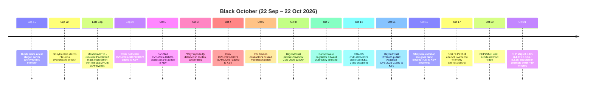
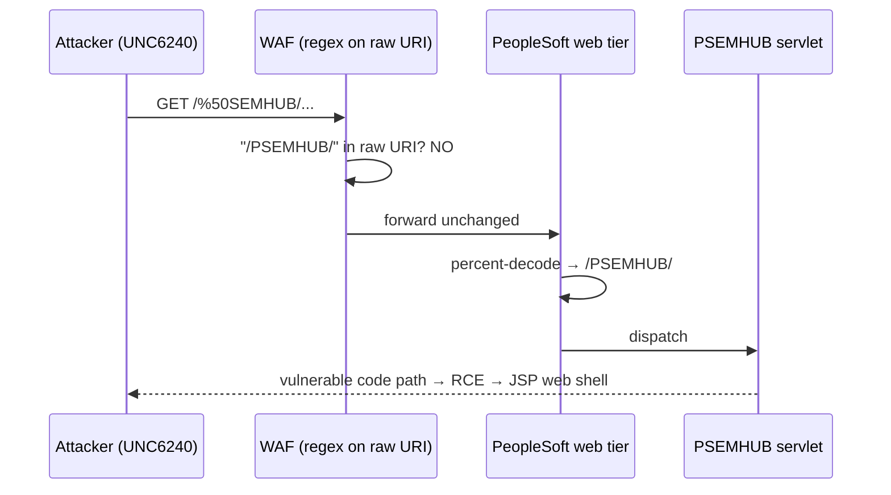

# Trick or Threat 🎃: Black October and the Haunted Patch Queue


## A technical post-mortem of 22 September – 22 October 2026: one extortion crew, one runtime, three edge-device zero-days, and how to stop leaving the porch light on

**By Oblivion Edge Vulnerability Research**

*"Double, double toil and trouble; fire burn and cauldron bubble."*
--- The Witches, *Macbeth*, Act IV, Scene 1

> **Spooky season disclaimer.** "Black October" is the name *we* are using for the 30-day window covered here. It is not a vendor's or government's label. Every CVE, date, and claim below links back to a source in [§12](#12-references). Where the sources disagree, the post says so instead of picking whichever version is scarier. The PHP2Shell story is less than 48 hours old at time of writing, so expect it to change.

---

## Table of Contents

0. [TL;DR — The Black October Scoreboard](#0-tldr--the-black-october-scoreboard)
1. [The 30-Day Timeline](#1-the-30-day-timeline)
2. [#1 — ShinyHunters: The Headless Horseman Rides Into the FBI](#2-1--shinyhunters-the-headless-horseman-rides-into-the-fbi)
3. [#2 — PHP2Shell: The Call Is Coming From Inside the Runtime](#3-2--php2shell-the-call-is-coming-from-inside-the-runtime)
4. [#3 — Citrix NetScaler: The Gateway Ghost (Again)](#4-3--citrix-netscaler-the-gateway-ghost-again)
5. [#4 — BeyondTrust Remote Support: The Butler Did It](#5-4--beyondtrust-remote-support-the-butler-did-it)
6. [#5 — FortiMail: Something Wicked Through the Mail Slot](#6-5--fortimail-something-wicked-through-the-mail-slot)
7. [Honorable (Dis)Mentions](#7-honorable-dismentions)
8. [Patterns in the Graveyard: What Black October Teaches](#8-patterns-in-the-graveyard-what-black-october-teaches)
9. [Theme: Modernizing the Haunted House (Nginx, Config, IP Limiting, DoS)](#9-theme-modernizing-the-haunted-house)
10. [Theme: Data at Rest and in Transit — Lessons From the Fortress of Solitude](#10-theme-data-at-rest-and-in-transit--lessons-from-the-fortress-of-solitude)
11. [The Exorcism Checklist](#11-the-exorcism-checklist)
12. [References](#12-references)

---

## 0. TL;DR — The Black October Scoreboard

| Rank | Name | Identifier(s) | Bug class | Severity | Exploited in the wild? | CISA KEV | Real fix |
|---|---|---|---|---|---|---|---|
| **#1** | **ShinyHunters** vs. Oracle PeopleSoft (incl. FBI Jobs) | CVE-2026-35273 + a claimed second PeopleSoft 0-day | Unauth flaw in the PSEMHUB servlet chained to RCE; WAF bypass by percent-encoding | CVSS 9.8 | **Yes** — mass exploitation, renewed late Sept | Yes (earlier in 2026) | Oracle's June 10 patch; remove/disable PSEMHUB |
| **#2** | **PHP2Shell** | CVE-2026-109618, CVE-2026-109619 | OOM-bailout memory corruption; stale global state → UAF | CVSS v4 9.2 (both) | **Disputed** — attempts confirmed; Sophos reports successful exploitation; CISA says not observed (Oct 21) | Not yet | PHP 8.5.12 / 8.4.27 / 8.3.36 / 8.2.35 |
| **#3** | **Citrix NetScaler ADC/Gateway** | CVE-2026-88771, -88772, -88779 (+ more) | Input validation → command exec; memory overflow (DTLS); memory overflow (SAML) | 88772 = CVSS v4 9.5 | **Yes** — global | Yes — Sep 27 & Oct 4 | Citrix fixed builds (see §4) |
| **#4** | **BeyondTrust Remote Support** | CVE-2026-102764 (BT26-05) | Auth bypass (CWE-290) → file operations → web shell | CVSS v4 9.3 / NVD v3.1 9.8 | **Yes** — China-nexus espionage since late Aug | Reported Oct 16 | BT26-05 patch |
| **#5** | **Fortinet FortiMail** | CVE-2026-104286 (FG-IR-26-175) | Path traversal + NULL byte → unauth arbitrary file write | CVSS 9.8 | **Yes** | Yes — Oct 1 | 8.0.2 / 7.6.7 / 7.4.9; disable IBE meanwhile |

**The one-sentence version:** Every major incident this month got in through a web-facing component that sits in front of something valuable (an HR portal, a VPN, a remote-access broker, a mail gateway, or the language runtime under half the internet). In at least one case (#1), the defender's "fix" was a regex in a WAF instead of the patch.

---

## 1. The 30-Day Timeline



---

## 2. #1 — ShinyHunters: The Headless Horseman Rides Into the FBI

We have written about this crew twice already. The [condensed graph-theory post](../ShinyHunters/ShinyHunters_Condensed.md) and the [full write-up](../ShinyHunters/ShinyHunters.md) cover the PeopleSoft infrastructure, SIDEEYE / MeshAgent / LA.exe, and backup-destruction capability. This section covers only what changed inside the Black October window.

### 2.1 What happened

| Date | Event | Source |
|---|---|---|
| Sep 15 | Dutch police arrest convicted hacker and alleged senior member Pepijn van der Stap. His Signal messages reportedly show contacts with ransom negotiators in Canada and the US. | Krebs |
| Sep 22 | ShinyHunters claims a breach of the FBI's jobs platform (`fbijobs.gov`). They threaten to publish employee files, including medical and psychological records and SSNs. Their stated motive is pressuring the FBI to retract a May report on the group. | SecurityWeek, Krebs |
| Late Sep | Google (Mandiant/GTIG, tracking **UNC6240**) warns of **renewed mass exploitation** of CVE-2026-35273, now with a **WAF-bypass** modification. | BleepingComputer, THN, eSecurityPlanet |
| Oct 2 | ShinyHunters says it does *not* plan to release the FBI data. | Hackaday, S-RM |
| Oct 3 | "Rey" (Saif al-Din Khader), who reportedly took over the ShinyHunters brand, is reported detained in Jordan and cooperating. | SecurityWeek, Krebs |
| Oct 6 | The FBI attributes the breach to *"a security failure of a platform managed by a third-party organization"*. Reuters' sources name an Accenture contractor who missed a PeopleSoft patch. The FBI removed the contractor. | SecurityWeek |
| Oct 9 | Canadian cybersecurity executive Edward Dubrovsky is arrested and charged with extortion. Signal messages allegedly show he knew about the FBI theft before the public threat. | Krebs |
| Oct 16 | **Shinywire**, the pay-up-or-else portal (active since ~May 3, ~100 victims), goes dark. Investigators suspect at least one US consulting-firm executive helped run it. | Krebs, Cybernews |

The FBI says the group extorted **more than $70 million in 2026**.

> **The plot twist nobody wanted:** Investigators allege that people paid to *negotiate on behalf of victims* learned of breaches before the victims did. The "trusted third party" here was a contractor who missed a patch, and possibly also the negotiator. Remember that when §8 talks about supply-chain trust.

### 2.2 The technical core: CVE-2026-35273 and the one-character WAF bypass

**The bug.** CVE-2026-35273 (CVSS 9.8) is an unauthenticated flaw in the **PeopleSoft Enterprise PeopleTools 8.61 / 8.62 "Updates Environment Management" component**. That is the **Environment Management Hub servlet at `/PSEMHUB/`**. Our earlier analysis describes it as SSRF chained to remote code execution. Oracle shipped the fix on **June 10, 2026**. Mandiant traced exploitation back to **May 27**, so this was a zero-day for two weeks and has been an n-day for four months.

**The bypass.** Organizations that couldn't or wouldn't patch deployed WAF rules matching the literal string `/PSEMHUB/`. UNC6240 changed one byte:

```text
GET /PSEMHUB/...      ← blocked by the WAF rule
GET /%50SEMHUB/...    ← %50 is 'P'. WAF string-match misses it.
                         The Java servlet container decodes it and routes to PSEMHUB.
```

This is an old class of bug (CWE-180, "validate before canonicalize"). The WAF inspected the URI *as sent*, but the application server routed on the URI *after decoding*. Any time two components parse the same input differently, the attacker can pick the gap.



**Post-exploitation.** Google reports web shells on dozens of systems across higher education, technology, IT services, healthcare, agriculture, transportation, and government. Our previous posts documented the SIDEEYE / MeshAgent / LA.exe toolkit and the backup-destruction capability.

**The FBI angle.** ShinyHunters claims FBI Jobs was breached through a *different, previously unknown* PeopleSoft vulnerability, not CVE-2026-35273. The FBI's public account (a contractor missed a patch) fits CVE-2026-35273 better. Both could be true. Treat the "second 0-day" as **unverified**, but act as if it exists: if a PeopleSoft instance must face the internet, assume more than one bug is reachable.

### 2.3 How to mitigate (today)

1. **Patch.** Apply Oracle's June 10 fix. After that, the WAF bypass doesn't matter, because the bypass only defeats a *workaround*.
2. **Remove PSEMHUB from the internet.** Disable or remove the Environment Management Hub if you don't use it (most production tenants don't need it public). Otherwise restrict it to an admin network.
3. **If you must keep a WAF rule, match on the normalized path.** Decode first (repeatedly, to catch `%2550` double encoding), uppercase, then match. See §9.2 for the nginx version.

### 2.4 How to hunt (assume you were hit)

Search access logs for **both literal and encoded** forms. Grepping for `PSEMHUB` alone is the same mistake the WAF made:

```bash
# Decode each line twice (catches %50 and %2550), then search case-insensitively.
python3 -I -c '
import sys, urllib.parse as u
for line in sys.stdin:
    d = u.unquote(u.unquote(line))
    if "PSEMHUB" in d.upper():
        print(line, end="")
' < /var/log/peoplesoft/access.log
```

Then:

- **Look for JSP or executable files in PeopleSoft web directories** that aren't in your deployment baseline. Mandiant explicitly recommends this. A quick triage is `find "$PS_CFG_HOME" -type f \( -name '*.jsp' -o -name '*.class' -o -name '*.exe' -o -name '*.sh' \) -newer <known-good-file>`.
- **Look for outbound connections** from the web tier to anything that isn't your database or IdP. Our earlier IOC tables are in [ShinyHunters_Condensed §8](../ShinyHunters/ShinyHunters_Condensed.md#8-indicators-of-compromise).
- **Check backups first.** Our earlier analysis rated backup destruction a *capability* of this toolkit. Verify you have an immutable, offline copy before you start eviction (see §10.4).

### 2.5 How to fix (structurally)

- **Patch SLAs keyed to KEV and CVSS, not to the change calendar.** An unauthenticated 9.8 RCE with a public exploit needs a deadline in days, not "next quarterly window."
- **Make contractors' patch status *your* telemetry.** The FBI's breach came down to "a platform managed by a third-party organization." Put vulnerability-scan results for vendor-managed systems in the contract, with timelines and audit rights.
- **Phishing-resistant MFA everywhere.** Krebs' Intuitive Surgical example (credentials phished from an employee) shows the group doesn't depend on any one CVE.
- **Plan for extortion before it happens.** Decide in advance who talks to the attacker, through which firm, and how that firm is vetted. This month showed that the negotiator can be part of the threat model.

---

## 3. #2 — PHP2Shell: The Call Is Coming From Inside the Runtime

PHP2Shell is ranked #2 because of reach, not confirmed body count. PHP runs a huge share of the web, and these bugs are in the **engine**, so they can trigger **before any application code runs**. A perfectly written WordPress or Laravel site is still exposed.

### 3.1 The two bugs

| | **CVE-2026-109618** | **CVE-2026-109619** |
|---|---|---|
| Advisory | GHSA-w8hw-w9fx-j79w | GHSA-6wmf-4rv5-p3rp |
| One-liner | An out-of-memory bailout leaves request data **partially initialized**, and shutdown treats it as valid | **Request-owned global state survives** after its memory is freed, and the next request on the same worker reads it |
| Primitive | Use of uninitialized/invalid memory during request shutdown | Heap use-after-free + memory disclosure |
| Trigger | Attacker-induced OOM. Multipart parsing is the documented path. | Two requests to the same worker. **`session.upload_progress`** is the confirmed path; PHP 8.5 `fatal_error_backtraces` is another. |
| Requests needed | 1 per attempt (mod_php) | 2 on the same worker |
| CVSS v4 | 9.2 (AV:N/AC:H/AT:P/PR:N/UI:N/VC:H/VI:H/VA:H) | 9.2 (same vector) |

**Why AC:H / AT:P?** Reliable exploitation depends on allocator layout, the exact build, and worker scheduling. That makes it *harder*, not *hard*: there is a public PoC, and within hours of the patch attackers were changing payloads to get around Cloudflare's emergency WAF rules.

**The quiet killer: memory disclosure.** Even without code execution, CVE-2026-109619 can read **worker memory left over from other users' requests**. Researchers demonstrated it against applications they didn't control. Passwords, session tokens, API keys, and TLS material that passed through that worker are all exposed. That makes this a Heartbleed-shaped problem on top of an RCE.

**Fun bit of archaeology.** The PHP Foundation says a core developer noticed signs of the OOM flaw during the **2024 external audit**, but no code-execution route was found then. "Unexploitable" memory bugs tend not to stay that way.

### 3.2 Who's exposed (SAPI matrix)

| SAPI | Risk | Notes |
|---|---|---|
| **Apache mod_php** (prefork) | 🔴 **Highest** | RCE demonstrated for **both** CVEs with default limits. Can fire before app code runs. |
| **PHP-FPM** | 🟠 High | FPM kills a worker that fails early in setup, which blocks one OOM path. But **session-lifecycle RCE (109619) was validated** under suitable application conditions. |
| php-cgi, FrankenPHP, LiteSpeed | 🟠 At risk | Listed by PHP. Fewer public specifics. |

**Affected:** essentially every PHP from **5.4 through 8.5**.

### 3.3 Timeline (UTC, Oct 20–21)

| Time | Event |
|---|---|
| Oct 17 | Amazon telemetry records an exploitation attempt **four days before disclosure** |
| Oct 20 | A leak claims disclosure for Oct 22. PHP posts advance notice and moves the release up. |
| ~20:00 Oct 20 | Researcher accidentally publishes a video of a working PoC |
| 03:02 Oct 21 | Cloudflare enables WAF rules by default (attackers reportedly adapt) |
| 07:41 Oct 21 | Chainguard ships patched images *before* the official release |
| 11:26 Oct 21 | watchTowr: no exploitation in the wild yet |
| 14:00 Oct 21 | **PHP 8.5.12 / 8.4.27 / 8.3.36 / 8.2.35 released** |
| 14:19 Oct 21 | watchTowr: **active exploitation attempts** against both CVEs |
| Oct 21 | CISA: exploitation not observed, not in KEV. Sophos: successful exploitation in customer environments. |

Nineteen minutes passed between the release and confirmed exploitation attempts. "We'll patch next sprint" stopped being a plan for this one at 14:19.

### 3.4 How to fix: patch, then prove it

| Branch | Fixed in |
|---|---|
| 8.5 | **8.5.12** |
| 8.4 | **8.4.27** |
| 8.3 | **8.3.36** |
| 8.2 | **8.2.35** |
| 7.4 / 8.0 / 8.1 | EOL upstream. Source backports exist in php-src; get vendor/distro builds or upgrade. |

**Trap #1: distro version strings.** Debian, Ubuntu, and RHEL backport fixes without bumping the upstream version number. Check the package changelog for the CVE IDs, not `php -v` alone.

**Trap #2: the PHP you checked isn't the PHP that serves traffic.** Containers, hosting panels, appliance-bundled PHP, and parallel branches all exist. Inventory the *serving* runtime:

```bash
#!/usr/bin/env bash
# php2shell_inventory.sh — report the PHP version inside every running container
# and whether it meets the PHP2Shell fixed version for its branch.
fixed_for() {
  case "$1" in
    8.5) echo 8.5.12 ;; 8.4) echo 8.4.27 ;; 8.3) echo 8.3.36 ;; 8.2) echo 8.2.35 ;;
    *)   echo "EOL" ;;
  esac
}
for c in $(docker ps -q); do
  name="$(docker inspect -f '{{.Name}}' "$c")"
  v="$(docker exec "$c" sh -c 'command -v php >/dev/null && php -r "echo PHP_VERSION;"' 2>/dev/null)" || continue
  [ -z "$v" ] && continue
  branch="${v%.*}"; want="$(fixed_for "$branch")"
  if [ "$want" = "EOL" ]; then
    echo "[EOL ] $name  php $v  (check vendor backport changelog)"
  elif [ "$(printf '%s\n%s\n' "$want" "$v" | sort -V | head -1)" = "$want" ]; then
    echo "[ OK ] $name  php $v  (>= $want)"
  else
    echo "[VULN] $name  php $v  (needs $want)"
  fi
done
```

**Trap #3: you patched the binary but not the workers.** Restart *every* FPM pool and Apache instance. Long-lived workers keep the old code mapped in memory.

**Trap #4: the patch changes OOM behavior.** The fix adds a **hard memory ceiling that kills the process and skips shutdown handlers**. Code that relies on `register_shutdown_function()` to flush queues or release locks under memory pressure can now leave work half-done. Load-test after patching.

### 3.5 How to mitigate (only if you truly can't patch yet)

PHP is explicit: **no configuration fully mitigates this; only updating does.** These measures shrink the attack surface while the change ticket moves. Apply them with `php_admin_value`, **not** `ini_set()` or `.user.ini`. Neither of those works for these settings, and the attacker gets in before your code runs anyway.

```ini
; /etc/php/8.x/fpm/pool.d/www.conf  — INTERIM PHP2Shell hardening
; --- CVE-2026-109619: close the confirmed session paths ---
php_admin_value[session.upload_progress.enabled] = 0
; PHP 8.5 only:
php_admin_value[fatal_error_backtraces] = 0

; --- CVE-2026-109618: make attacker-driven OOM harder ---
; PHP's interim advice is memory_limit=-1, set administratively so apps can't
; lower it. Pair it with a cgroup/container memory limit for availability, and
; RESTORE a finite limit once patched. Do NOT use RLIMIT_AS / RLIMIT_DATA:
; they force the same vulnerable allocation-failure path.
php_admin_value[memory_limit] = -1
php_admin_value[post_max_size] = 8M          ; 32M if you genuinely need uploads
php_admin_value[upload_max_filesize] = 6M    ; keep below post_max_size
php_admin_value[max_file_uploads] = 5
php_admin_value[max_input_vars] = 1000
php_admin_value[max_input_nesting_level] = 32
php_admin_value[max_multipart_body_parts] = 100

; Optional, costly: one request per worker removes the cross-request reuse
; that 109619 needs. Measure before you ship it.
; pm.max_requests = 1
```

Also remove any **invalid or deprecated per-request INI** (`php_value` in Apache config, `.htaccess`, or `PHP_VALUE` set by a front end). Diagnostics emitted before initialization are one of the documented triggers.

And at the edge, before PHP sees the request (full config in §9):

```nginx
# Cap the decoded body. Applies even when Content-Length is absent (chunked).
client_max_body_size 8m;

location ~ \.php$ {
    # If this app never accepts uploads, multipart has no business reaching PHP.
    if ($content_type ~* "multipart/form-data") { return 415; }
    # ... fastcgi_pass etc.
}
```

### 3.6 How to detect

Watch for these **even on already-patched hosts**, in case you were hit before patching:

- Multipart POSTs followed by `Allowed memory size ... exhausted` or other memory-limit errors
- Bursts of HTTP **500** from PHP upstreams
- **Unusually large `PHPSESSID` `Set-Cookie`** values in responses
- Unexplained PHP worker restarts (`child NNNN exited on signal 11 (SIGSEGV)` in the FPM log)

An nginx `log_format` that records these signals:

```nginx
log_format php2shell '$msec $remote_addr "$request" $status '
                     'up=$upstream_status rl=$request_length ct="$content_type" '
                     'rt=$request_time cookie_len=${sent_http_set_cookie}';
```

```bash
# Multipart requests answered with 5xx, grouped by client
awk '/ct="multipart/ && $0 ~ /up=5[0-9][0-9]/ {print $2}' /var/log/nginx/php2shell.log \
  | sort | uniq -c | sort -rn | head
# Worker crashes in FPM
grep -E 'exited on signal (11|6)|Allowed memory size' /var/log/php*-fpm.log | tail -50
```

**After any suspected hit:** rotate every secret that could have been in worker memory, including DB passwords, API keys, session signing keys, and OAuth client secrets. The memory-disclosure primitive leaves no file on disk to find.

---

## 4. #3 — Citrix NetScaler: The Gateway Ghost (Again)

NetScaler is on this list for what seems like the fifth year running. This round has **ten CVEs** across three Citrix bulletins. Three of them matter most:

| CVE | What | Precondition | Status |
|---|---|---|---|
| **CVE-2026-88771** | Improper input validation → unauthenticated arbitrary command execution *(third-party description; not confirmed in Citrix's bulletin text we could reach)* | All ADC/Gateway on vulnerable builds | **KEV Sep 27**, exploited globally |
| **CVE-2026-88772** | Memory overflow (CWE-119) → RCE, CVSS v4 **9.5** | **DTLS enabled**, which is the default on VPN vServers | **KEV Sep 27**, exploited globally |
| **CVE-2026-88779** | Memory overflow → DoS; on unpatched systems it can **force a reboot that helps execute code injected via 88771** | SAML SP or IdP configured | **KEV Oct 4** |

Others: CVE-2026-88773 through -88778 and CVE-2026-107406 (bulletins CTX697096, CTX697174, CTX697191).

**The chain worth understanding:** 88779 is more than "just a DoS." CISA notes that attackers can use the forced reboot to *activate* a payload staged through 88771. A "low-severity" availability bug ends up completing an RCE chain. Never deprioritize a DoS on an edge device without asking what a reboot does for the attacker.

### How to fix

- Upgrade to **14.1-73.37+ / 13.1-64.23+** (and the FIPS/NDcPP equivalents) for 88771/88772. If you have SAML configured, **upgrade again** to **14.1-73.41 / 13.1-64.28** for 88779. Patching once in late September is not enough. *(Build numbers come from Citrix's bulletins as quoted by secondary sources. Verify in CTX697096 / CTX697174.)*

### How to mitigate and hunt

1. **Check for compromise *before* patching.** CISA warns that updates can reduce forensic visibility. Image or preserve first.
2. **Ship NetScaler logs off the box** to a SIEM. Local logs rotate fast, and attackers wipe them.
3. Use the IOCs in **NetScaler Console** and CISA's **SIGMA rules** (`cisagov/SIGMA_Rules`, added Oct 2).
4. If you're compromised, **restore from a known-good pre-compromise backup**, then rotate **local account passwords, KEKs, and SSL certificates**. Citrix's CTX694799 is the runbook. Patching a backdoored appliance leaves you with a patched backdoored appliance.

---

## 5. #4 — BeyondTrust Remote Support: The Butler Did It

A remote-support appliance holds the keys to every system its technicians touch. Compromising it gives an attacker those keys too.

- **CVE-2026-102764**, advisory **BT26-05**, disclosed Oct 15. CVSS v4 **9.3** (NVD v3.1: **9.8**).
- **Bug class:** authentication bypass (CWE-290) in an internal messaging component. It lets an unauthenticated attacker perform **file operations** (sources also describe arbitrary file upload).
- **Affected:** Remote Support **26.2.3 and earlier**. Privileged Remote Access shares the code; BeyondTrust patched it as a precaution but found no exploit path.
- **Actor:** **ARMORY CASTLE** (Mandiant; formerly **UNC5221**) / **Warp Panda** (CrowdStrike), suspected PRC-nexus espionage. First use **Aug 29**, against one SaaS instance and one self-hosted appliance.
- Shadowserver counted **1,400+** exposed instances.

### The kill chain (Mandiant/GTIG)

```text
auth bypass ──► web shell ──► web-svc account → root (SUID abuse)
            ──► SAWFLY (custom PHP web shell) + BARECLAW tunneler
            ──► log wiping
            ──► stolen admin creds → remote sessions on DOWNSTREAM systems
            ──► persistence that survives reboot AND config reset
```

Note that **SAWFLY is a PHP web shell**, which connects this incident to #2. The appliance's management stack is PHP. A runtime-level bug (PHP2Shell) and an application-level bug (this one) both end with a PHP shell on a device that holds everyone's credentials.

### How to fix and mitigate

- **SaaS:** patched by BeyondTrust on Oct 8 (sources vary between Oct 8 and Oct 15).
- **Self-hosted 24.3.1 → 26.2.3:** apply BT26-05 or confirm auto-update installed it. Older releases must upgrade first.
- **Treat any internet-reachable appliance that was on a vulnerable version since late August as compromised until reviewed.** Look for new SUID binaries, gaps in logs, web-root files outside your baseline, and Administrator sessions to downstream hosts at odd hours.
- **Rotate every credential the appliance stored or brokered.** Because the persistence survives a config reset, a "factory reset and carry on" leaves the attacker in place. Rebuild from known-good media.

---

## 6. #5 — FortiMail: Something Wicked Through the Mail Slot

- **CVE-2026-104286**, Fortinet **FG-IR-26-175**, CVSS **9.8**, found internally by Fortinet PSIRT, **exploited in the wild**.
- **Bug class:** path traversal (CWE-22) + improper NULL-byte neutralization (CWE-158) → **unauthenticated arbitrary file write** over HTTP/S.
- **KEV:** added **Oct 1**, federal deadline **Oct 4**.
- **Affected:** 8.0.0–8.0.1, 7.6.0–7.6.6, 7.4.0–7.4.8, 7.2.0–7.2.9 (NVD data reportedly also includes 7.0.x).
- **Fixed:** 8.0.2, 7.6.7, 7.4.9. **7.2 users must move to 7.4+.** At disclosure, fixes weren't yet released and sources still disagree on current status, so check the advisory.

### From file write to code execution

A file-write primitive becomes code execution when the attacker controls *what loads*. One analysis (Wiz, treat with caution) describes a dropped shared library at `/data/lib/liblog.so` plus a modified **`/etc/ld.so.preload`**. After that, every dynamically linked process on the box loads attacker code. It is an old trick that still works.

**Why the NULL byte?** A classic pattern is a check like "filename must end in `.png`" that runs on the full string, while the lower-level C API stops at the first `\0`. So `../../../data/lib/liblog.so\0.png` passes validation and gets written as `.../liblog.so`. This is the same validate-then-canonicalize mismatch as the PeopleSoft WAF bypass, in a different layer.

### How to mitigate (now)

```text
config system encryption ibe
    set status disable
end
```

Then **block internet access to the management interface** or restrict it to a trusted network. Hunt with the files, IPs, and log entries in FG-IR-26-175, and **check `/etc/ld.so.preload`** on any appliance where you can get a shell. On a healthy appliance it should be empty or absent.

---

## 7. Honorable (Dis)Mentions

| Item | Why it didn't make the Top 5 | What to do |
|---|---|---|
| **PAN-OS CVE-2026-0322** (Oct 14) | Exploited and in KEV with a **3-day** federal deadline, but **requires valid credentials** on an internet-exposed management interface. Palo Alto published 3 attacker IPs. Cloud NGFW and Prisma Access unaffected. | Patch. **Never expose the management interface.** Rotate admin creds. Threat Prevention signatures only partly cover it, and two require SSL decryption. |
| **Atlassian CVE-2026-21589** (KEV Oct 15) | Multi-product access flaw, exploited. Few public technical details. | Patch per Atlassian's advisory. Audit for new admin accounts and API tokens. |
| **Windows CVE-2026-96951** (Oct Patch Tuesday) | Reported as the one actively exploited zero-day in a record 1,413-CVE release. **The details come from a low-quality source and are unconfirmed.** | Apply October cumulative updates. Confirm against MSRC before quoting the CVE. |
| **ShinyHunters' "second PeopleSoft 0-day"** | Claimed, not demonstrated. | Assume it exists. Get PeopleSoft off the open internet behind an authenticated proxy. |

---

## 8. Patterns in the Graveyard: What Black October Teaches

**8.1 The edge is the target.** NetScaler, FortiMail, BeyondTrust, PAN-OS, and a PeopleSoft portal facing the internet: four of the five headliners are appliances or portals whose *whole job* is to sit on the internet and broker access to something internal. They are hard to monitor (closed OS, limited EDR) and highly privileged. Defenders should stop treating them as trusted infrastructure.

**8.2 A WAF rule is a speed bump.** PeopleSoft (`%50SEMHUB`) and PHP2Shell (payloads mutated within hours of Cloudflare's rules) both showed that signature-based filtering buys hours, not months. A WAF is a good bridge to a patch, and it fails as a replacement for one.

**8.3 Canonicalization bugs never die.** `%50` vs `P`. `file.so\0.png` vs `file.so`. Raw `$request_uri` vs normalized `$uri`. Whenever two components interpret the same bytes differently, the attacker gets to choose which interpretation wins. **Normalize once, early, then validate the normalized form, and pass that same form downstream.**

**8.4 Memory-safety bugs in C runtimes keep paying out.** PHP2Shell is a UAF and an uninitialized-memory bug in a 30-year-old C codebase that powers a large fraction of the web. Citrix 88772/88779 are memory overflows. This is the strongest argument yet for memory-safe rewrites of edge-facing parsers.

**8.5 Trust is the vulnerability.** A contractor's missed patch exposed the FBI. Negotiators allegedly knew about breaches before victims did. A remote-support tool became a lateral-movement highway. The question to ask is "who can reach my systems, and what happens when *they* get owned?", not only "what's my CVSS backlog?"

---

## 9. Theme: Modernizing the Haunted House

> *Nginx modernization, securing the configuration, IP limiting, DoS detection and verification.*

For this section we use the **Fortress of Solitude**, our encrypted file vault (Django + Gunicorn + Nginx on Cloud Run), as the worked example of doing it right. The general hardening patterns that follow apply to any web stack, so you can hold your own site up against them. Earlier Fortress posts: [Encryption](../05-03-2025_FortressOfSolitude_Encryption.md), [Kryptonian Cryptography in Django](../05042025_KryptonianCryptographyInDjango.md), [Securing Data at Rest](../11-2-2025_Securing_Data_At_Rest.md).

> **Why the specifics are light here.** The Fortress is a live service. This post describes *which* controls it uses and *why*, but deliberately leaves out exact thresholds, endpoint names, and blocklist contents. Telling attackers how fast they can go before getting banned is not a defensive act.

### 9.1 What the Fortress gets right

**My verdict up front:** after reading the code and deploy scripts and checking the live deployment, the Fortress of Solitude is a **highly secure website**. It is hardened beyond what most commercial websites ship. Most production sites we look at don't have even half of this: per-endpoint rate limits, automatic IP banning built from a real threat hunt, a strict header set, an app server that never faces the internet, ephemeral runtime data, a secret key regenerated on every deploy, and per-object envelope encryption, so a stolen database is ciphertext. What a large enterprise adds on top is mostly *scale* and *process*: DDoS scrubbing, a 24/7 SOC, third-party pentests. Those are a different job from building it right.

| Control | How it's done | Black October relevance |
|---|---|---|
| **App server never faces the internet** | Gunicorn binds to loopback; only Nginx listens externally | The opposite of an exposed PSEMHUB or a management interface |
| **Tiered rate limiting** | Separate `limit_req` zones for authentication, API/upload, and general traffic, plus a slow "hammer" zone | Brute force is throttled before the application ever sees it |
| **Connection limits + slowloris timeouts** | `limit_conn` per IP, short body/header/send timeouts, `reset_timedout_connection on` | Cheap layer-7 DoS defense |
| **Two-tier IP banning** | Nginx throttles in real time; a watcher daemon turns persistent offenders into temporary `deny` rules | Hammers get shown the door automatically |
| **Threat-hunt-driven blocklist** | Datacenter ranges observed in a real hunt are closed with `444` (no response at all) | Defense built from evidence, not guesswork |
| **Strict security headers** | CSP, `Permissions-Policy`, COOP, `nosniff`, frame denial, `no-store` on auth pages, `Secure` CSRF cookie (verified live) | Limits XSS, clickjacking, and cache leakage |
| **Method allowlist; dotfiles denied** | `405` on anything off-list; dot-paths denied | `.env`/`.git` stay private |
| **Nothing advertised** | `server_tokens off`; the only `Server` header is Google Frontend | Version-targeted scanning has nothing to work with |
| **Envelope encryption at rest** | Per-object DEKs wrapped by KEKs, AES-EAX (authenticated) | See §10 |
| **Ephemeral runtime data, by design** | The data directory is a container volume that is wiped on restart; the only durable copy is the off-site backup, and `docker commit` never captures volume contents | Nothing private lingers in a container or an image |
| **Consistent backups with integrity checks** | `sqlite3 .backup` (not `cp`) + `PRAGMA integrity_check` + off-site copy | Recovery from ShinyHunters-style destruction |
| **Fresh secret on every deploy** | The deploy script generates a strong `SECRET_KEY` and injects it at deploy time; the file holding it is excluded from git and from the build | No default key in prod |
| **Cold-start fix shipped** | Deployed with a warm minimum instance and CPU boost | Removes the false-alarm 502s the threat hunt traced to scaling from zero |
| **Cost-DoS ceiling** | Hard cap on autoscaling instances | A flood can't autoscale your bill to the moon |
| **No credentials in env vars** | Admin creation passes credentials through a short-lived file that is deleted on both sides after use | Creds never show up in the service description |
| **Versioned, migrated-before-live images** | Semantic-version validation; migrations run *before* the image is pushed | Clean rollbacks; no half-migrated prod |
| **Public data, public key** | The only key material in configuration protects the *public* research tab (posts anyone can read without logging in); user data is keyed per user | Nothing secret depends on a value in the repo |
| **Verifying before banning** | The Oct 16 threat hunt concluded the 502s were **cold starts, not an attack** | See §9.5 |

### 9.2 Lesson from PeopleSoft: match on the *normalized* URI

The `%50SEMHUB` bypass works against any filter that inspects the URI *as sent* while the backend routes on the URI *after decoding*. In nginx terms, that is the difference between two variables:

- **`$request_uri`**: the raw, undecoded URI **including the query string**.
- **`$uri`**: percent-decoded and normalized (`//` merged, `.` and `..` resolved, requests that climb above root rejected with 400). **`location` matching uses this one.**

A hand-rolled "WAF map" on `$request_uri` is a common pattern, and it inherits the PeopleSoft problem:

| Probe | Rule on raw `$request_uri` | Caught? | Why |
|---|---|---|---|
| `/../etc/passwd` | `~*\.\.` | ✅ | literal match |
| `/%2e%2e/%2e%2e/%65tc/passwd` | `~*\.\.`, `~*/etc/passwd` | ❌ | encoded characters never match the literals |
| `/shell.php?x=1` | `~*\.php$` | ❌ | `$` anchors at the end of the *query string* |
| `/shell.php/` | `~*\.php$` | ❌ | trailing slash |
| `/%50SEMHUB/` | `~*/PSEMHUB` | ❌ | the PeopleSoft bypass itself |

Rules written as `location` blocks inherit nginx's normalization for free:

```nginx
# Match on the normalized path, so encoding tricks don't help.
location ~* \.(php|asp|aspx|jsp|cgi)(/|$)     { return 404; }
location ~* /(wp-admin|wp-login|phpmyadmin)    { return 404; }
location ~* ^/PSEMHUB                           { return 404; }   # /%50SEMHUB/ decodes to this

# Separately reject double-encoding on the raw URI: there's rarely a legitimate
# reason for %25 followed by hex in an application's routes.
map $request_uri $double_encoded {
    default          0;
    ~*%25[0-9a-f]{2} 1;
}
```

**One more subtlety:** `proxy_pass http://127.0.0.1:8000;` (no URI part) forwards the **original raw URI** to the upstream, not the normalized one. The upstream must be safe against encoded input on its own. The Fortress gets this right by design: files are served through authenticated views that look up records in the database, never by mapping a URL onto the filesystem, so there is no path to traverse. Defense in depth means **both** layers validate.

**SQLi/XSS regexes** (`union.*select`, `<script`) at the proxy are useful as tripwires for logging, but treat them as **noise filters, not protection**. The real protection is parameterized queries (the Django ORM) and template auto-escaping. Logged hits are threat intel (§9.5).

### 9.3 Secure-configuration patterns

General patterns worth checking in any nginx + app-server deployment:

**The `add_header` inheritance trap.** In nginx, `add_header` directives are inherited from the enclosing level **only if the current level defines no `add_header` of its own.** Any `location` that sets even one header (say, `Cache-Control` on static files) silently drops every server-level security header on those responses. Put the headers in a snippet and include it wherever a location sets its own:

```nginx
# /etc/nginx/snippets/security-headers.conf
add_header Strict-Transport-Security "max-age=63072000; includeSubDomains; preload" always;
add_header X-Content-Type-Options "nosniff" always;
add_header Referrer-Policy "strict-origin-when-cross-origin" always;
add_header Permissions-Policy "camera=(), microphone=(), geolocation=()" always;
add_header Content-Security-Policy "default-src 'self'; script-src 'self'; style-src 'self'; img-src 'self' data:; font-src 'self'; frame-ancestors 'none'; base-uri 'self'; form-action 'self'; object-src 'none'" always;
add_header Cross-Origin-Opener-Policy "same-origin" always;
add_header Cross-Origin-Resource-Policy "same-origin" always;
# X-XSS-Protection is deprecated and ignored by modern browsers; CSP replaces it.
```

```nginx
location /static/ {
    alias /app/staticfiles/;
    expires 30d;
    add_header Cache-Control "public, immutable";
    include snippets/security-headers.conf;   # ← re-include; otherwise they vanish here
}
```

If both the framework (e.g., Django's `SecurityMiddleware`) and nginx set headers, pick **one layer to own each header**. When duplicates conflict, browsers resolve them in ways you didn't choose.

**Fail closed on secrets.** Production settings should refuse to start without their secrets, rather than falling back to a development default:

```python
import os
from django.core.exceptions import ImproperlyConfigured

def require_env(name: str) -> str:
    value = os.environ.get(name)
    if not value:
        raise ImproperlyConfigured(f"{name} must be set in production")
    return value

SECRET_KEY = require_env("DJANGO_SECRET_KEY")
ALLOWED_HOSTS = require_env("APP_ALLOWED_HOSTS").split(",")   # explicit hosts, never "*"
```

On Cloud Run, **Secret Manager** (`--set-secrets=...`) keeps values out of the service description, and **Cloud KMS** keeps root keys out of the application entirely (§10.2).

**Least privilege in the container.** Run as a non-root `USER`, use a read-only root filesystem with `tmpfs` for scratch space, drop capabilities, and use multi-stage builds so compilers don't ship in the runtime image. Every exploit in this post ended with "web service account → something more." Don't start at root.

**Mind the build context.** `.dockerignore` patterns without `**/` only match at the context root, so `*.sqlite3` does not exclude `some/dir/db.sqlite3`. Use `**/*.sqlite3`, `**/*.key`, and explicit directory entries for anything that holds data, logs, or keys. Check with a throwaway build (`COPY . /ctx` + `RUN find /ctx ...`) to see exactly what goes in.

**Never log key material.** Use `logging` at DEBUG level instead of `print()` on crypto error paths. In the cloud, stdout goes to a log service with very different access controls from your key store.

### 9.4 IP limiting done right

**Know who `$remote_addr` really is.** Behind a load balancer or CDN, nginx may see the *proxy's* address instead of the client's. Then every user shares one rate-limit bucket, and an auto-banner can end up **banning your own load balancer**. Verify with one request and check the access log. If the first field isn't your public IP, configure the realip module with *only* your trusted proxy ranges:

```nginx
# http {} — trust X-Forwarded-For ONLY from your proxy tier
set_real_ip_from 10.0.0.0/8;          # ← replace with your LB/proxy ranges
real_ip_header   X-Forwarded-For;
real_ip_recursive on;
```

> Never `set_real_ip_from 0.0.0.0/0`. That lets any client spoof `X-Forwarded-For: 1.2.3.4` to dodge your limits or frame someone else for a ban.

**An allowlist that skips rate limits** (owner, monitoring) without `if`:

```nginx
geo $limit_exempt {
    default 0;
    203.0.113.10/32 1;    # owner
}
map $limit_exempt $limit_key {
    0 $binary_remote_addr;
    1 "";                 # empty key = request not counted by limit_req
}
limit_req_zone $limit_key zone=auth:10m    rate=3r/s;
limit_req_zone $limit_key zone=general:10m rate=10r/s;
```

**Line windows vs. clock windows.** The Fortress's ban daemon uses a **share-of-recent-traffic** detector: it looks at a rolling window of the most recent *logged requests* and flags any address that holds an outsized share of them. That is a deliberate choice, and a smart one:

- **It's pace-independent.** A clock window (N requests per 60 s) can be evaded by an attacker who paces just under the threshold forever: 59 requests a minute is still 85,000 a day. A line window doesn't care how slowly requests arrive. If one address keeps dominating what the server has *recorded*, it gets flagged.
- **It's a second tier.** Nginx's `limit_req` already enforces per-second limits. The daemon catches whoever keeps coming back after being throttled, and it also watches the rate-limited log for repeat offenders.
- **It self-scales on a small site.** On a low-traffic service, one address owning a large slice of recent traffic is anomalous whatever the time span.

| Situation | Line window | Clock window |
|---|---|---|
| Slow, persistent single-IP hammer | ✅ caught | ❌ evades by pacing |
| Single-IP burst | ✅ caught (and `limit_req` throttles first) | ✅ caught |
| Distributed flood (many IPs, few requests each) | ❌ | ❌ |
| Legit heavy user on a quiet site | ⚠ allowlist them | ✅ usually fine |

Distributed floods beat *every* per-IP detector. That's upstream territory: Cloud Armor, a CDN, or per-ASN/prefix aggregation.

**Hygiene for any auto-banner:** validate addresses before writing them into nginx config, use fixed-string matching (`grep -F`) when checking a ban list (a `.` in an IP is a regex wildcard), and run `nginx -t` before every reload. **CrowdSec** (community reputation plus an nginx bouncer) or **fail2ban** can add shared blocklists, persistence, and IPv6 prefix aggregation on top. Banning a single `/128` means little when an attacker holds a `/64`.

**User-agent blocking is a tripwire, not a lock.** It stops lazy `sqlmap` and `curl` runs. Anyone serious sends a Chrome UA string. Keep it for the noise reduction, but don't count it as a control.

### 9.5 DoS detection and verification

**Detection: what to watch.**

| Signal | Source | What it means |
|---|---|---|
| 429 rate climbing | nginx `$status` | Limits are working. *Who* is hitting them? |
| 444 rate | nginx | Blocklist hits (connection dropped) |
| 499 spikes | nginx | Clients giving up, so latency is too high (possibly under load) |
| 502/504 spikes | nginx + upstream | Backend saturation, crash, **or cold start** |
| `$request_time` p95/p99 | custom `log_format` | Slow-path abuse (expensive endpoints, regex DoS) |
| Many open conns, few requests | `stub_status` (`Reading`/`Waiting`) | Slowloris-style connection holding |
| `limiting requests` / `limiting connections` | nginx `error.log` | Which zone fired, for which key |

```nginx
location = /_nginx_status {
    stub_status;
    allow 127.0.0.1;
    deny all;
}
```

**Verification: prove the controls work, and prove it's really an attack.**

1. **Test your limits on staging, with your own traffic.** Never point load tools at systems you don't own.

   ```bash
   # 40 rapid POSTs to a rate-limited login endpoint on YOUR staging host.
   # Expect roughly (rate + burst) to reach the app and the rest to get 429.
   UA='Mozilla/5.0 (X11; Linux x86_64) Chrome/130.0 Safari/537.36'   # if you block curl's UA, as you should
   for i in $(seq 1 40); do
     curl -sk -o /dev/null -w '%{http_code}\n' -A "$UA" -X POST https://staging.example.internal/login/
   done | sort | uniq -c
   ```

   For sustained load, use `k6` or `vegeta` at a fixed rate and confirm `limit_req` holds the upstream at the configured ceiling. For slowloris, run `slowhttptest` against staging and confirm your header timeout drops held connections.

2. **Correlate before you call it an attack.** The Fortress's Oct 16 hunt is the model to copy. It took the IPs active just before each 502, enriched them (ASN, rDNS, netblock), and found that **known-friendly addresses were in the "suspect" list**. The failure pattern (a few requests, then a 502) matched **scaling from zero**. The fix was a warm minimum instance, not more bans. *Verify, then ban.*

3. **Separate the three DoS shapes:**
   - **Volumetric** (Gbps floods): nginx can't help, because the pipe is full before packets arrive. That is the job of your CDN or cloud (Cloud Armor, Cloudflare).
   - **Protocol/connection** (slowloris, SYN, HTTP/2 rapid reset): timeouts, `limit_conn`, an up-to-date nginx, and `http2_max_concurrent_streams`.
   - **Application** (expensive endpoints, login hammering, multipart bombs like PHP2Shell's OOM trigger): `limit_req`, `client_max_body_size`, and fixing the expensive code path.

### 9.6 Putting it together: a modern nginx skeleton

A generic starting point for an app server behind nginx:

```nginx
# /etc/nginx/conf.d/app.conf  (http context)
server_tokens off;

set_real_ip_from 10.0.0.0/8;           # your proxy tier only
real_ip_header   X-Forwarded-For;
real_ip_recursive on;

geo $limit_exempt { default 0; }
map $limit_exempt $limit_key { 0 $binary_remote_addr; 1 ""; }
limit_req_zone  $limit_key zone=auth:10m    rate=3r/s;
limit_req_zone  $limit_key zone=api:10m     rate=5r/s;
limit_req_zone  $limit_key zone=general:10m rate=10r/s;
limit_conn_zone $binary_remote_addr zone=addr:10m;
limit_req_status  429;
limit_conn_status 429;

map $request_uri $double_encoded { default 0; ~*%25[0-9a-f]{2} 1; }
map $request_method $bad_method  { default 1; ~^(GET|HEAD|POST|PUT|PATCH|DELETE|OPTIONS)$ 0; }

log_format sec '$msec $remote_addr $status "$request" rl=$request_length rt=$request_time '
               'up=$upstream_status ct="$content_type" "$http_user_agent"';

upstream app { server 127.0.0.1:8000; keepalive 16; }

server {
    listen 443 ssl;
    http2 on;
    server_name app.example.com;

    include snippets/tls-modern.conf;          # §10.5
    include snippets/security-headers.conf;    # §9.3

    access_log /var/log/nginx/sec.log sec;

    client_max_body_size        50m;           # size to your uploads; PHP sites usually far lower
    client_body_timeout         10s;
    client_header_timeout       10s;
    send_timeout                10s;
    keepalive_timeout           30s;
    reset_timedout_connection   on;
    http2_max_concurrent_streams 64;
    limit_conn addr 20;

    if ($bad_method)     { return 405; }       # return-only 'if' is safe
    if ($double_encoded) { return 400; }

    # Normalized-path denials ($uri, not $request_uri)
    location ~ /\.                                 { return 404; }
    location ~* \.(php|asp|aspx|jsp|cgi)(/|$)      { return 404; }

    location ~ ^/(login|register)/ {
        limit_req zone=auth burst=5 nodelay;
        include snippets/proxy-app.conf;
    }
    location ~ ^/(upload|api)/ {
        limit_req zone=api burst=10 nodelay;
        include snippets/proxy-app.conf;
    }
    location /static/ {
        alias /app/staticfiles/;
        expires 30d;
        add_header Cache-Control "public, immutable";
        include snippets/security-headers.conf;
    }
    location / {
        limit_req zone=general burst=20 nodelay;
        include snippets/proxy-app.conf;
    }
}
```

```nginx
# snippets/proxy-app.conf
proxy_pass http://app;
proxy_http_version 1.1;
proxy_set_header Connection "";
proxy_set_header Host              $host;
proxy_set_header X-Real-IP         $remote_addr;
proxy_set_header X-Forwarded-For   $proxy_add_x_forwarded_for;
proxy_set_header X-Forwarded-Proto $scheme;
proxy_connect_timeout 5s;
proxy_read_timeout    60s;     # longer only on upload locations
```

---

## 10. Theme: Data at Rest and in Transit — Lessons From the Fortress of Solitude

Every headliner this month ended with **data leaving the building**: FBI employee files, PHP worker memory, credentials brokered by BeyondTrust, mail on FortiMail. You can't make breaches impossible. You can make the stolen data **worthless**, and that is where the Fortress design pays off.

### 10.1 What the Fortress does: envelope encryption

```text
user secret ──► KEK (key-encryption key, per user)
                  │  wraps
                  ▼
                DEK (data-encryption key, per object) ──► AES-EAX(file/note) → ciphertext + 16-byte tag
```

- **Per-object DEKs.** Compromising one object's key exposes one object.
- **DEKs are stored wrapped**, never in plaintext next to the data.
- **AES-EAX is authenticated encryption.** Tampered ciphertext fails tag verification instead of decrypting to garbage, which defeats the bit-flipping and padding-oracle tricks that plain CBC allows.
- **Public and private are separated.** The public research tab, which anyone can read without logging in, has its own key path. Private user data never shares it.
- **A stolen database is ciphertext.** If ShinyHunters walked off with the Fortress database, they'd hold encrypted blobs and wrapped keys, not readable files.

That is the property the FBI's HR records, and every PeopleSoft tenant this month, didn't have.

### 10.2 Patterns for any encrypted store

If you're building your own vault, these are the patterns to reach for:

**Use a memory-hard KDF for anything derived from a password.** A single fast hash lets an attacker with your database try billions of guesses per second on a GPU. **Argon2id** is the current standard, and the Python `cryptography` package ships it:

```python
import os
from cryptography.hazmat.primitives.ciphers.aead import AESGCM
from cryptography.hazmat.primitives.kdf.argon2 import Argon2id

def derive_kek(password: bytes, salt: bytes) -> bytes:
    # 64 MiB, 3 passes, 4 lanes. Tune so a derive takes ~250 ms on your hardware.
    return Argon2id(salt=salt, length=32, iterations=3, lanes=4,
                    memory_cost=64 * 1024).derive(password)

def wrap_dek(kek: bytes, dek: bytes, record_id: bytes) -> bytes:
    nonce = os.urandom(12)
    # AAD binds the wrapped key to its record, so it can't be swapped onto another row.
    return nonce + AESGCM(kek).encrypt(nonce, dek, record_id)

def unwrap_dek(kek: bytes, blob: bytes, record_id: bytes) -> bytes:
    return AESGCM(kek).decrypt(blob[:12], blob[12:], record_id)
```

Store the per-user random salt and the Argon2 parameters alongside the wrapped KEK, so you can raise the cost later and re-wrap on next login.

**Bind ciphertext to context with AAD.** Include the record ID (and owner ID) as associated data, so an attacker with database *write* access can't swap one user's encrypted note into another user's row.

**Keep root keys in KMS.** With **Cloud KMS** (or an HSM), the app sends a wrapped key and gets the unwrapped key back, and the root key never leaves the KMS. A full repo-plus-database leak still lacks the root of the hierarchy, and every unwrap lands in Cloud Audit Logs.

**Plan for post-quantum.** Anything protected by RSA or classic ECDH today is exposed to harvest-now-decrypt-later. Our [RiddlerChat PQC post](../07-14-2026-PostQuantumCryptography-TheRiddlerChatSystem.md) covers hybrid ML-KEM + X25519.

### 10.3 Secrets hygiene (the stuff PHP2Shell would have stolen)

- **Short-lived credentials.** Use workload identity instead of static keys wherever possible. The Fortress backup daemon already does this: it gets its storage access from the metadata server, with no key file.
- **Rotate on suspicion, not on schedule.** After any memory-disclosure bug (PHP2Shell, the next Heartbleed), assume every secret that passed through process memory is burned.
- **Separate what the web tier can read.** The process that parses untrusted HTTP shouldn't hold root key material. Put unwrapping behind a small internal service or a KMS call.

### 10.4 Backups that survive an extortion crew

The Fortress backup daemon gets the hard parts right: a consistent `.backup` snapshot, an integrity check, an off-site copy, and automatic restore when a fresh container starts empty. For the ShinyHunters threat model, any backup design should also have:

1. **Client-side encryption before upload** (`age -r <recipient-pubkey>`), or a **CMEK** default key on the bucket, so metadata and table structure are protected too, not just the encrypted payloads.
2. **Immutability.** If the workload that *writes* backups can also *delete* them, an attacker who controls the workload controls your backups. Enable **Object Versioning + Soft Delete + a retention policy**, and give the writer create-only permissions:

   ```bash
   gcloud storage buckets update gs://YOUR-BACKUP-BUCKET \
       --versioning --soft-delete-duration=30d --retention-period=14d
   # Writer service account: roles/storage.objectCreator (no delete)
   ```

3. **Restore drills.** Restore into a scratch environment on a schedule. A backup you've never restored is only a hope.

### 10.5 Data in transit

**Public edge.** Cloud Run terminates TLS with Google-managed certs, which is good. On the live Fortress endpoint, every byte between the browser and Google's edge is encrypted with **AES-256-GCM** (`TLS_AES_256_GCM_SHA384`) over **TLS 1.3**, on HTTP/2 and HTTP/3. TLS 1.3 key exchange is always ephemeral, so each session gets a fresh AES-256 key and forward secrecy is guaranteed: a key stolen tomorrow can't decrypt traffic recorded today. And because the whole `.app` TLD is on the browser HSTS preload list, browsers refuse to talk to it over plain HTTP at all.

For self-hosted nginx, a modern TLS baseline:

```nginx
# snippets/tls-modern.conf
ssl_protocols TLSv1.2 TLSv1.3;
ssl_ciphers ECDHE-ECDSA-AES256-GCM-SHA384:ECDHE-RSA-AES256-GCM-SHA384:ECDHE-ECDSA-CHACHA20-POLY1305:ECDHE-RSA-CHACHA20-POLY1305:ECDHE-ECDSA-AES128-GCM-SHA256:ECDHE-RSA-AES128-GCM-SHA256;
ssl_prefer_server_ciphers off;          # let clients pick; all options are strong
ssl_session_timeout 1d;
ssl_session_cache shared:TLS:10m;
ssl_session_tickets off;                # tickets undermine forward secrecy unless keys rotate
# With OpenSSL >= 3.5, add hybrid post-quantum key exchange:
# ssl_ecdh_curve X25519MLKEM768:X25519:prime256v1;
# With a publicly trusted cert:
# ssl_stapling on; ssl_stapling_verify on;
```

Every suite listed uses ECDHE (forward secrecy) and an AEAD cipher. Static-RSA suites like `AES256-GCM-SHA384` don't provide forward secrecy and should be left out. The ML-KEM hybrid line needs OpenSSL 3.5+ (Ubuntu 24.04 ships 3.0), and it's worth doing for anything harvest-now-decrypt-later matters to.

**Internal hops.** Nginx → app server over `127.0.0.1` inside one container never touches a network, which is exactly how the Fortress does it. Once services split across hosts (app ↔ DB, app ↔ KMS proxy), use **mTLS** with short-lived certs. "It's on the internal network" is the assumption BeyondTrust's downstream victims made.

**Verify it.** `testssl.sh https://your.host` (or `sslscan`) should show no TLS 1.0/1.1, no suites without forward secrecy, and your security headers on *every* response.

---

## 11. The Exorcism Checklist

**This week (incident-driven)**

- [ ] PeopleSoft: Oracle June 10 patch applied; PSEMHUB disabled or off-internet; logs hunted for `PSEMHUB` **and** encoded variants; web dirs checked for unexpected JSP/executables
- [ ] PHP: every *serving* runtime at 8.5.12 / 8.4.27 / 8.3.36 / 8.2.35 or distro equivalent; workers restarted; secrets rotated if exposed before patching
- [ ] PHP interim (if blocked): `session.upload_progress.enabled=0` via `php_admin_value`; body-size limits at the proxy; multipart blocked where unused
- [ ] NetScaler: IOC check **before** patching; 14.1-73.41 / 13.1-64.28 if SAML is in use; logs off-box; creds/KEKs/certs rotated if compromised
- [ ] BeyondTrust: BT26-05 applied; appliances exposed since late Aug reviewed as compromised; brokered creds rotated
- [ ] FortiMail: IBE disabled, management interface off-internet, upgrade to fixed build; `/etc/ld.so.preload` checked
- [ ] PAN-OS: CVE-2026-0322 patched; management interface not internet-reachable

**This quarter (structural)**

- [ ] Patch SLA tied to KEV/CVSS (e.g., KEV + internet-facing = 72 h)
- [ ] Third-party/contractor patch status visible in *your* vulnerability management
- [ ] Phishing-resistant MFA (FIDO2) for every admin and remote-access path
- [ ] Edge appliance logs forwarded to a SIEM with retention beyond on-box rotation
- [ ] WAF rules match on normalized input, and are tracked as temporary with an expiry date
- [ ] Extortion playbook: vetted negotiator, legal, comms, decision authority

**Hardening your own web stack (the Fortress playbook)**

- [ ] App server bound to loopback; only the reverse proxy faces the internet
- [ ] Tiered `limit_req` zones (auth / API / general) + `limit_conn` + short timeouts
- [ ] Two-tier banning: real-time throttling plus a share-of-traffic daemon for persistent offenders; owner allowlisted; `nginx -t` before reload
- [ ] `realip` configured for trusted proxies only; confirm `$remote_addr` is the client
- [ ] Path rules on `$uri` / `location`, plus a double-encoding reject
- [ ] Security-header snippet included in every location that sets its own headers; one layer owns each header
- [ ] Secrets generated at deploy time, fail-closed settings, explicit `ALLOWED_HOSTS`; Secret Manager/KMS for anything sensitive
- [ ] Ephemeral runtime data; `**/`-style `.dockerignore`; non-root, read-only container
- [ ] Envelope encryption with authenticated ciphers; memory-hard KDFs; AAD binding
- [ ] Backups consistent, integrity-checked, encrypted, immutable; restore drills
- [ ] TLS 1.3 / ECDHE-only suites; HSTS (or a preloaded TLD); PQ hybrid when OpenSSL allows
- [ ] Rate limits and slowloris timeouts **tested on staging**; alerts on 429/499/5xx/p99 latency; *verify, then ban*

---

## 12. References

**ShinyHunters / PeopleSoft**

1. S-RM — [ShinyHunters claim FBI breach amid renewed PeopleSoft attacks (2 Oct 2026)](https://www.s-rminform.com/cyber-intelligence-briefing/shinyhunters-claim-fbi-breach-amid-renewed-peoplesoft-attacks-2-october-2026)
2. SecurityWeek — [FBI Blames Contractor's Missed Patch for ShinyHunters Breach](https://www.securityweek.com/fbi-blames-contractors-missed-patch-for-shinyhunters-breach/)
3. KrebsOnSecurity — [Feds Suspect Ransom Negotiator Ran ShinyHunters Extortion Site](https://krebsonsecurity.com/2026/10/feds-suspect-ransom-negotiator-ran-shinyhunters-extortion-site/)
4. Cybernews — [ShinyHunters probe: ransomware negotiators suspected](https://cybernews.com/security/shinyhunters-extortion-site-ransom-negotiators/)
5. BleepingComputer — [ShinyHunters uses WAF bypass trick in Oracle PeopleSoft attacks](https://www.bleepingcomputer.com/news/security/shinyhunters-uses-waf-bypass-trick-in-oracle-peoplesoft-attacks/)
6. The Hacker News — [Attackers bypass WAFs to exploit Oracle](https://thehackernews.com/2026/09/attackers-bypass-wafs-to-exploit-oracle.html)
7. eSecurityPlanet — [ShinyHunters Bypasses PeopleSoft WAF in Renewed Exploitation](https://www.esecurityplanet.com/cybersecurity-threats/news-shinyhunters-peoplesoft-waf-bypass/)
8. Cybernews — [ShinyHunters targeting Oracle zero-day days after FBI attack, Google warns](https://cybernews.com/security/shinyhunters-oracle-zero-day-fbi-attack-google-warning/)
9. Hackaday — [This Week In Security: ShinyHunters Won't Dox The FBI…](https://hackaday.com/2026/10/02/this-week-in-security-shinyhunters-wont-dox-the-fbi-pentagon-data-stolen-and-obs-vulnerable/)

**PHP2Shell**

10. The Hacker News — [PHP Issues Emergency Patches for Two Critical PHP2Shell RCE Flaws](https://thehackernews.com/2026/10/php-issues-emergency-patches-for-two.html)
11. Qualys — [PHP announces critical security release for two vulnerabilities](https://blog.qualys.com/vulnerabilities-threat-research/2026/10/20/php-announces-critical-security-release-for-two-vulnerabilities)
12. Sophos — [Proof-of-concept exploit released for PHP vulnerabilities](https://www.sophos.com/en-us/blog/proof-of-concept-exploit-released-for-php-vulnerabilities-109618-109619)
13. Google Cloud — [Responding to core PHP vulnerabilities CVE-2026-109618 and CVE-2026-109619](https://cloud.google.com/blog/products/identity-security/responding-to-core-php-vulnerabilities-cve-2026-109618-cve-2026-109619)
14. Infosecurity Magazine — [Critical PHP Vulnerabilities Leaked Ahead of Scheduled Security Patch](https://www.infosecurity-magazine.com/news/critical-php-vulnerabilities-leaked/)
15. SOCRadar — [PHP2Shell: Affected Versions & Fix](https://socradar.io/blog/php2shell-cve-2026-109618-cve-2026-109619/)
16. Aikido — [PHP2Shell: How to fix PHP RCE](https://www.aikido.dev/blog/critical-vulnerabilities-in-php-php2shell)
17. UW-IT — [Critical PHP vulnerabilities (Oct 2026)](https://it.uw.edu/help/servicestatus/php-cves/)

**Zero-days**

18. CISA — [Critical Zero-Day Vulnerabilities Exploited in Citrix NetScaler ADC, Gateway](https://www.cisa.gov/news-events/alerts/2026/09/27/critical-zero-day-vulnerabilities-exploited-citrix-netscaler-adc-gateway)
19. Citrix — [CTX697096](https://support.citrix.com/external/article/CTX697096)
20. CSO Online — [Citrix warns of actively exploited NetScaler flaw days after zero-day patch rush](https://www.csoonline.com/article/4230642/citrix-warns-of-actively-exploited-netscaler-flaw-days-after-zero-day-patch-rush.html)
21. BleepingComputer — [BeyondTrust patches zero-day exploited in attacks since August](https://bleepingcomputer.com/news/security/beyondtrust-patches-zero-day-exploited-in-attacks-since-august)
22. CSO Online — [BeyondTrust zero-day tied to Chinese spies](https://www.csoonline.com/article/4236421/beyondtrust-zero-day-tied-to-chinese-spies-puts-remote-support-users-on-alert.html)
23. eSecurityPlanet — [Google Warns China-Linked Hackers Exploited BeyondTrust Zero-Day](https://www.esecurityplanet.com/threats/news-beyondtrust-zero-day-china-hackers/)
24. Help Net Security — [Critical FortiMail zero-day exploited in the wild (CVE-2026-104286)](https://www.helpnetsecurity.com/2026/10/02/fortinet-fortimail-vulnerability-cve-2026-104286/)
25. Cybersecurity Dive — [Fortinet critical flaw FortiMail exploitation](https://www.cybersecuritydive.com/news/fortinet-critical-flaw-fortimail-exploitation/832017/)
26. Wiz — [CVE-2026-104286](https://www.wiz.io/vulnerability-database/cve/cve-2026-104286)
27. BleepingComputer — [Palo Alto Networks warns of PAN-OS RCE flaw exploited in attacks](https://bleepingcomputer.com/news/security/palo-alto-networks-warns-of-pan-os-rce-flaw-exploited-in-attacks)
28. CISA — [CISA Adds One Known Exploited Vulnerability to Catalog (Oct 15)](https://www.cisa.gov/news-events/alerts/2026/10/15/cisa-adds-one-known-exploited-vulnerability-catalog)

**Background**

29. nginx docs — [`add_header` inheritance](https://nginx.org/en/docs/http/ngx_http_headers_module.html#add_header), [`$uri` vs `$request_uri`](https://nginx.org/en/docs/http/ngx_http_core_module.html#var_uri), [`proxy_pass` URI handling](https://nginx.org/en/docs/http/ngx_http_proxy_module.html#proxy_pass), [realip module](https://nginx.org/en/docs/http/ngx_http_realip_module.html)
30. MITRE — [CWE-180: Incorrect Behavior Order: Validate Before Canonicalize](https://cwe.mitre.org/data/definitions/180.html)
31. Wolf Den — [ShinyHunters (Condensed)](../ShinyHunters/ShinyHunters_Condensed.md), [ShinyHunters (Full)](../ShinyHunters/ShinyHunters.md), [Securing Data at Rest](../11-2-2025_Securing_Data_At_Rest.md)

---

*Happy Halloween. Patch your stuff. The monsters are real, and they read the same advisories you do.* 🎃
